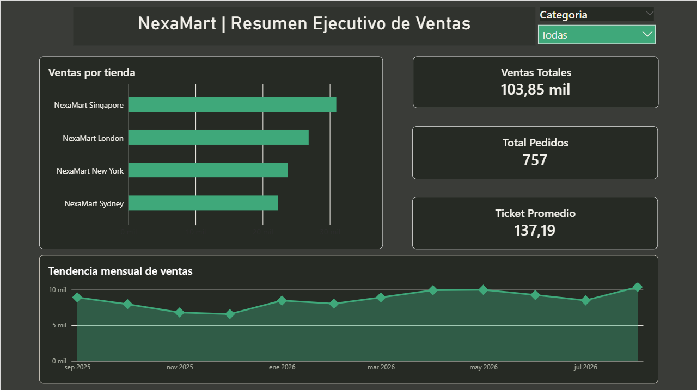
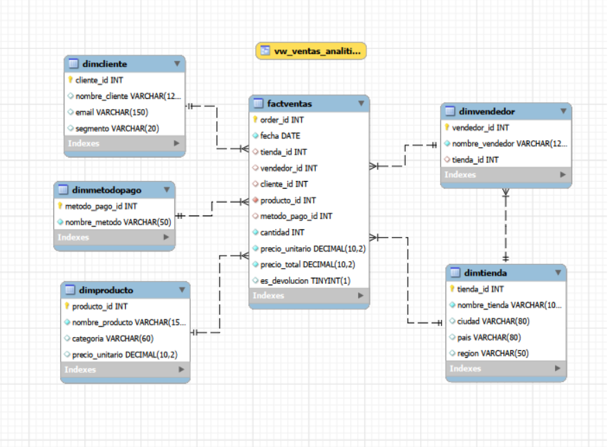
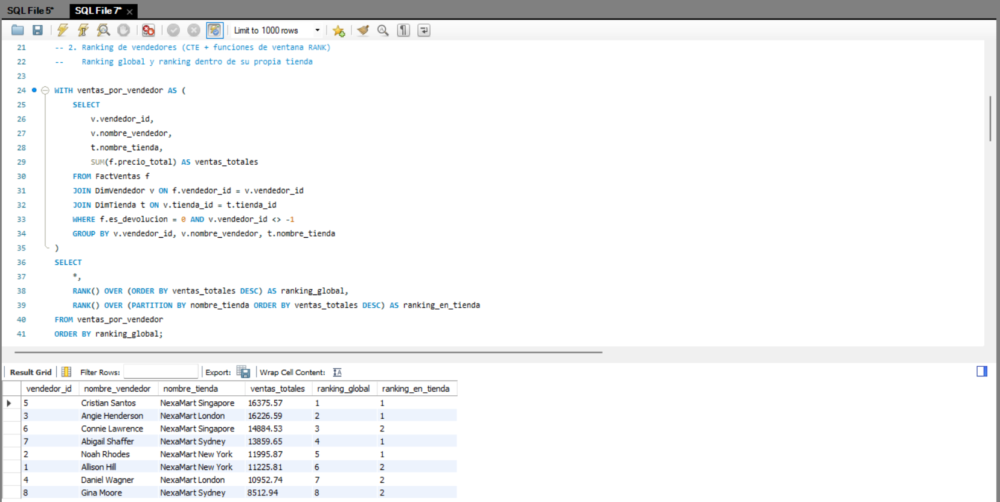
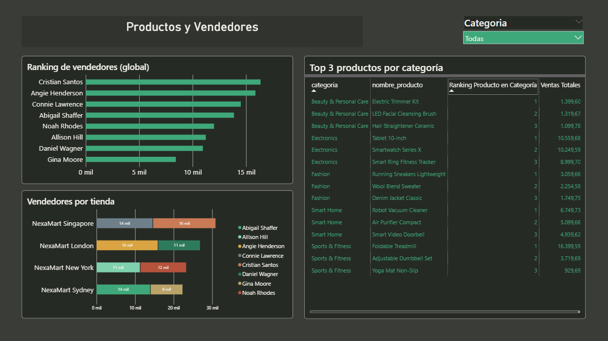
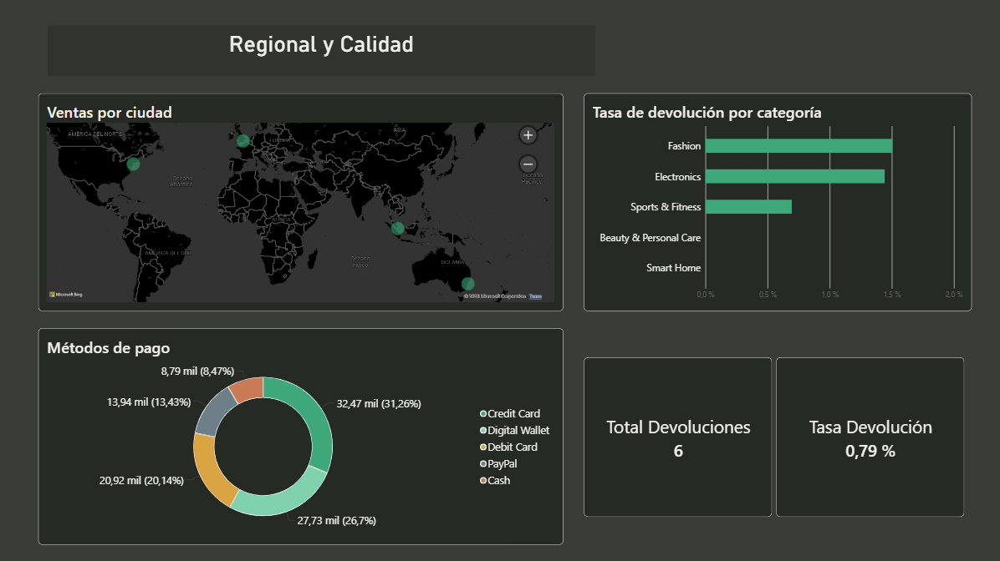
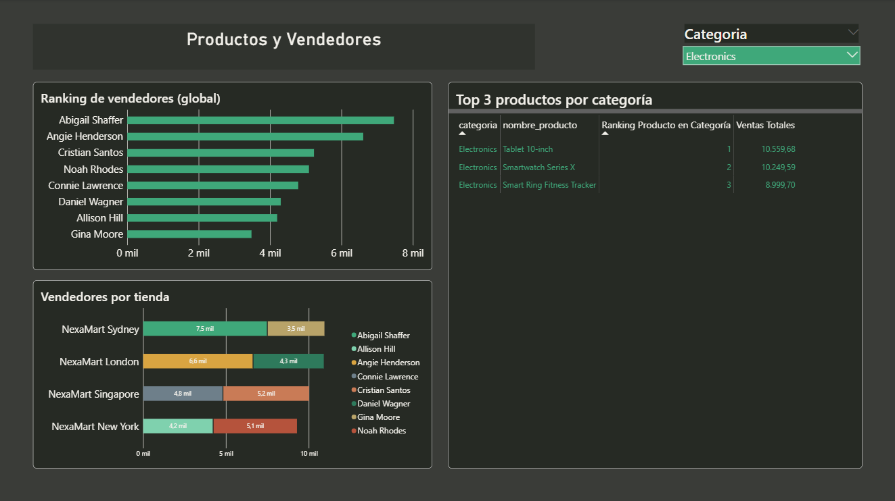

# NexaMart | Análisis de ventas retail multi-tienda

**Python · MySQL · Power BI · DAX**

Proyecto de análisis de datos de principio a fin: preparación de transacciones, modelado relacional, consultas SQL y un dashboard para comparar el desempeño de cuatro tiendas internacionales.

> **Resultado:** una base con **757 registros**, consultas analíticas y **tres páginas de Power BI** que conectan ventas, productos, vendedores y devoluciones. Empresa y datos simulados con fines de portafolio; no representan resultados de una organización real.

## El problema y el objetivo

NexaMart es una cadena ficticia con tiendas en **New York, London, Singapore y Sydney**. El caso plantea una gerencia que necesita comparar tiendas, identificar productos y vendedores destacados y revisar devoluciones desde una misma fuente de información.

Construí una solución que integra preparación de datos en Python, una base analítica en MySQL y visualización en Power BI. El objetivo es facilitar preguntas comerciales concretas y mostrar las decisiones técnicas que hacen confiable el análisis.

## Alcance y herramientas

| Elemento | Alcance |
|---|---|
| Período | Septiembre de 2025 a agosto de 2026 |
| Tiendas | 4, distribuidas en 4 países |
| Catálogo | 31 productos en 5 categorías |
| Clientes | 170 generados, más el registro «No registrado» |
| Vendedores | 8 identificados, más el registro «No registrado» |
| Pagos | Credit Card, Debit Card, Digital Wallet, PayPal y Cash |
| Preparación | Python y Faker, según el proceso documentado |
| Base y análisis | MySQL, claves foráneas, JOINs, CTEs y funciones de ventana |
| Visualización | Power BI, DAX, calendario y filtros por categoría |

**Flujo:** CSV de origen → limpieza en Python → modelo analítico en MySQL → conexión en modo Import → dashboard en Power BI.

## Decisiones de calidad de datos

El origen se generó con inconsistencias intencionales para practicar un proceso ETL: fechas en tres formatos, duplicados, identificadores faltantes, devoluciones y cantidades atípicas.

| Tratamiento documentado | Resultado |
|---|---:|
| Filas de origen | 765 |
| Duplicados exactos eliminados | 5 |
| Cantidades atípicas apartadas para revisión | 3 |
| **Registros finales** | **757** |
| Sin cliente identificado, conservados con clave `-1` | 10 |
| Sin vendedor identificado, conservados con clave `-1` | 6 |
| Devoluciones conservadas como eventos de negocio | 6 |

La conciliación es **765 − 5 − 3 = 757**. Los nulos en cliente y vendedor no implican perder la transacción. Las devoluciones se identifican mediante `es_devolucion`; los outliers quedan para revisión. El conteo final está respaldado por una captura de MySQL; los detalles del ETL proceden del proceso documentado y requieren los archivos originales para su verificación completa.

## Modelo de datos

`FactVentas` concentra fecha, cantidad, precio e identificadores. Se relaciona con `DimTienda`, `DimVendedor`, `DimProducto`, `DimCliente` y `DimMetodoPago`. Power BI incorpora `DimCalendario` para el análisis temporal.

Dos decisiones relevantes:

- **Integridad referencial:** cliente y vendedor pueden usar `-1` / «No registrado», conservando ventas sin identificación.
- **Filtros sin ambigüedad:** en Power BI cada dimensión filtra directamente la tabla de hechos; la relación adicional entre vendedor y tienda se retiró del modelo semántico. La relación continúa presente en MySQL.

**Grano de la versión actual:** una fila contiene un producto y un `order_id` único. La clave primaria permite una sola fila por pedido. Para admitir pedidos con varios productos se necesitaría una clave de línea independiente; esa extensión queda fuera de esta versión.

## SQL: de preguntas a consultas

El archivo [consultas_analiticas.sql](sql/consultas_analiticas.sql) contiene **las siete consultas compartidas y una vista analítica añadida al preparar esta publicación**.

| Pregunta de negocio | Técnica |
|---|---|
| ¿Qué tienda concentra más ventas? | JOIN y agregación |
| ¿Quién lidera globalmente y dentro de cada tienda? | CTE y `RANK() OVER` |
| ¿Cuáles son los tres productos con más ingresos por categoría? | CTE y `ROW_NUMBER()` particionado |
| ¿Qué participación tiene cada método de pago? | Subconsulta escalar y porcentaje |
| ¿Cómo evolucionan ventas y pedidos por mes? | Agrupación temporal |
| ¿Qué clientes VIP acumulan mayor gasto? | CTE, segmentación y Top 10 |
| ¿Qué categorías presentan mayor proporción de devoluciones? | `CASE` y agregación condicional |

El Top 3 se ordena por **importe**, no por unidades. El código preparado añade desempate por identificador y protección frente a división por cero. Las capturas muestran la ejecución de la versión original; la versión publicada aún requiere ejecución sobre la base original.

## Dashboard: tres vistas para decidir

### 1. Resumen ejecutivo

Compara tiendas y la tendencia mensual; presenta ventas totales, conteo de pedidos y ticket promedio. En la captura sin filtro, Singapore encabeza el importe mostrado por tienda.

### 2. Productos y vendedores

Relaciona el ranking comercial con el catálogo. Cristian Santos lidera el ranking general mostrado; la tabla permite identificar los tres productos con mayor importe dentro de cada categoría.

### 3. Regional y calidad

Integra distribución por ciudad, métodos de pago y devoluciones. Se observan **6 devoluciones sobre 757 registros: 0,79 %**. Es una proporción de registros marcados como devolución, no una tasa de unidades devueltas ni de pedidos originales devueltos.

### Interactividad

El filtro **Electronics** modifica el ranking y las ventas por tienda. Abigail Shaffer encabeza el ranking en esa selección, mostrando cómo cambia la lectura al segmentar el negocio.

## Métricas y alcance

- El dashboard muestra **103,85 mil**, **757 pedidos** y **137,19 de ticket promedio**. Los importes se presentan como unidades monetarias de simulación: no se dispone de una divisa base ni de reglas de conversión documentadas.
- Las consultas SQL comerciales excluyen devoluciones. El conteo del dashboard incluye los 757 registros, con sus 6 devoluciones. La definición de ventas y ticket debe conciliarse con las medidas del `.pbix` antes de comparar ambos resultados.
- Se observa una diferencia entre SQL y Power BI para Smartwatch Series X: **10.499,58** frente a **10.249,59**. Debe revisarse con los datos y medidas originales; no se atribuye una causa sin comprobarla.
- Hay 12 meses de datos, insuficientes para comparar cada mes con el mismo mes del año anterior. No se dispone de costos, margen, inventario ni metas; los resultados no demuestran rentabilidad ni impactos reales.

Estas precisiones permiten interpretar las visualizaciones sin atribuirles conclusiones que el caso no mide.

## Contenido disponible

| Ruta | Contenido |
|---|---|
| [sql/nexamart_schema.sql](sql/nexamart_schema.sql) | Esquema reconstruido a partir del DDL compartido; sin carga de datos |
| [sql/consultas_analiticas.sql](sql/consultas_analiticas.sql) | Siete consultas y vista analítica |
| [docs/decisiones_tecnicas.md](docs/decisiones_tecnicas.md) | ETL, modelo, DAX, métricas y límites de verificación |
| [capturas/README.md](capturas/README.md) | Índice de las diez evidencias originales |
| `capturas/` | Dashboard, filtro, base, modelos y consultas |

**Pendientes de incorporar:** CSV crudo, limpio y de revisión; generador con semillas; `etl_limpieza.py`; carga completa de MySQL; tema JSON; archivo `.pbix` y definiciones DAX exactas. Sus nombres describen entregables del proyecto; no están incluidos todavía.

## Cómo revisar esta entrega

1. Consulta las capturas y las decisiones técnicas para recorrer el proyecto.
2. En una instancia nueva de **MySQL 8.0 o superior**, ejecuta `sql/nexamart_schema.sql` para crear las tablas vacías. No incluye `DROP` ni elimina una base existente; si las tablas ya existen, utiliza una instancia de trabajo separada.
3. Importa la carga original cuando esté disponible; el esquema vacío no permite reproducir los resultados.
4. Ejecuta `sql/consultas_analiticas.sql` sobre la base cargada para revisar los análisis.
5. Para reproducir el dashboard se requiere el `.pbix`, la conexión MySQL y las medidas originales. Las capturas son evidencia visual, no sustituyen el archivo interactivo.

## Habilidades demostradas

**Calidad de datos y trazabilidad · Modelado relacional y dimensional · SQL analítico · Contexto de filtro en Power BI · DAX e inteligencia temporal · Comunicación de resultados y límites del análisis.**

El valor del proyecto está en conectar esas etapas en un caso coherente y explicar las decisiones que sostienen el resultado.
