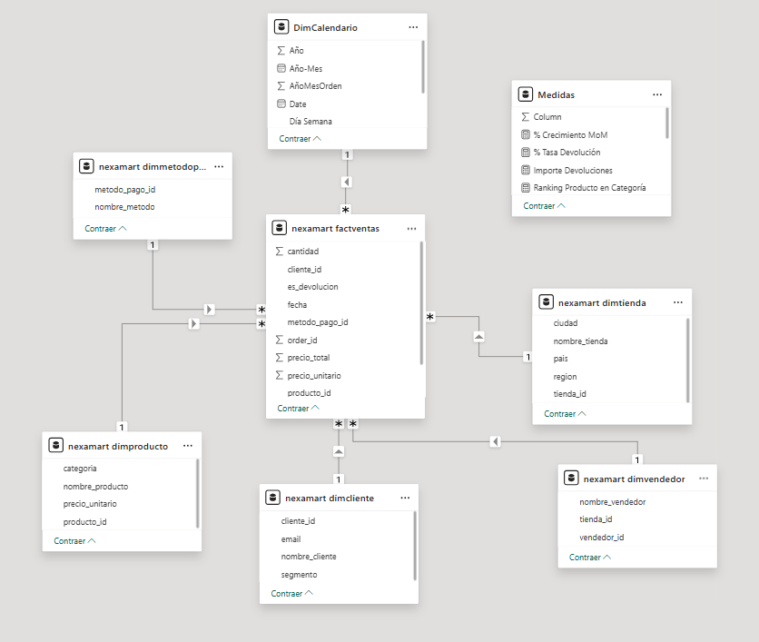

# NexaMart | Análisis comercial con SQL y Power BI

**SQL · MySQL · Power BI · DAX**

Análisis de ventas de una cadena ficticia con tiendas en **New York, London, Singapore y Sydney**. Utilicé SQL para comparar el desempeño comercial y Power BI para explorar los resultados y orientar decisiones sobre productos, vendedores y devoluciones.

**757 registros · 4 tiendas · 31 productos · 12 meses**  
Septiembre de 2025 a agosto de 2026. Datos simulados con fines de portafolio.

[Consultas SQL](sql/consultas_analiticas.sql) · [Dashboard Power BI](powerbi/NexaMart.pbix) · [Caso en Notion](https://app.notion.com/p/3f3711ab612481f9a5b6fe8d50bfbdbd)

## SQL: preguntas de negocio y análisis

El núcleo del proyecto son **diez consultas comerciales** sobre un modelo de ventas en MySQL, acompañadas de una vista consolidada para facilitar su consumo.

| Pregunta | Técnica SQL |
|---|---|
| ¿Qué tiendas generan más ventas? | JOIN y agregación |
| ¿Quién lidera globalmente y dentro de su tienda? | CTE + `RANK() OVER` |
| ¿Qué tres productos generan más ingresos por categoría? | CTE + `ROW_NUMBER()` particionado |
| ¿Qué peso tiene cada método de pago? | Subconsulta escalar y porcentajes |
| ¿Cómo evolucionan las ventas y los pedidos por mes? | Agrupación temporal |
| ¿Qué clientes VIP acumulan mayor gasto? | CTE, segmentación y Top 10 |
| ¿Qué categorías presentan más devoluciones? | `CASE` y agregación condicional |
| ¿Concilian bruto, devoluciones, neto y ticket? | Agregación condicional y conteo de compras |
| ¿Qué explica la brecha entre Singapore y Sydney? | CTEs y descomposición de volumen / ticket |
| ¿Qué categorías concentran esa brecha? | Agregación condicional y ventanas para participación |

**Ejemplo: ranking global y por tienda.** Una CTE calcula el importe por vendedor; las funciones de ventana permiten compararlo en ambos niveles sin perder el detalle:

```sql
SELECT *,
    RANK() OVER (
        ORDER BY ventas_netas DESC
    ) AS ranking_global,
    RANK() OVER (
        PARTITION BY tienda_id ORDER BY ventas_netas DESC
    ) AS ranking_en_tienda
FROM ventas_por_vendedor;
```

[Ver la consulta completa y las demás preguntas](sql/consultas_analiticas.sql).

[Ver ejecución original del ranking en MySQL](capturas/04_ranking_vendedores_sql.png). La consulta actual utiliza ventas netas.

**SQL y el PBIX actualizado comparten estas definiciones:**

| Indicador | Valor | Regla |
|---|---:|---|
| Ventas brutas | 104.718,63 | Eventos de venta |
| Importe devuelto | 866,89 | Devoluciones, presentado positivo |
| Ventas netas | 103.851,74 | Brutas − importe devuelto |
| Compras | 751 | Excluye eventos de devolución |
| Ticket promedio | 139,44 | Brutas / compras |

Rankings y participaciones se calculan sobre **ventas netas**. Los importes son unidades monetarias de simulación.

## Dashboard: respuestas y decisiones

### 1. Resumen ejecutivo — ¿Dónde se concentra el resultado?

**Respuesta:** Singapore supera a Sydney en **8.690,55 netos**. Tiene 197 compras frente a 177 y un ticket de 159,34 frente a 126,40. La descomposición atribuye **6.160,11 al ticket**, **2.857,39 al volumen** y **−326,95 a la diferencia de devoluciones**.

**Acción sugerida:** profundizar Sports & Fitness, que concentra **5.688,99 de la brecha con 37 compras en cada tienda**. Foldable Treadmill registra 20 unidades netas en Singapore frente a 4 en Sydney: revisar surtido, disponibilidad y cantidades por compra antes de plantear acciones comerciales.

[Ver análisis, método y resultados SQL](docs/conclusion_comercial.md).

*Capturas actualizadas del informe en Power BI Desktop, aportadas el 9 de octubre de 2026.*


### 2. Productos y vendedores — ¿Quién y qué impulsa las ventas?

**Respuesta:** Cristian Santos lidera entre vendedores identificados con **16.345,58 netos**. Foldable Treadmill es el producto con mayor importe: **16.399,59**. El Top 3 se calcula dentro de cada categoría y se ordena por ingresos.

**Acción sugerida:** revisar disponibilidad y promociones de los productos destacados y contrastar las prácticas de los vendedores líderes. El filtro por categoría permite ajustar esa comparación.


### 3. Regional y calidad — ¿Qué conviene vigilar?

**Respuesta:** Credit Card representa **31,26 % del importe neto**. Fashion presenta **1,50 % de registros de devolución** y Electronics **1,44 %**; en total son seis devoluciones de 757 registros (**0,79 %**). El mapa ubica las tiendas.

**Acción sugerida:** revisar los casos de devolución de ambas categorías y mantener seguimiento por período; comprobar también la continuidad de los medios de pago más utilizados.


Estas acciones son recomendaciones del caso, no mejoras económicas demostradas. Los ingresos no permiten concluir rentabilidad o productividad, y seis devoluciones no bastan para atribuir causas.

## De MySQL al modelo de Power BI

Las cinco dimensiones y ventas se importan desde MySQL. Las claves foráneas sostienen los JOINs; en Power BI, las relaciones **1:* con filtro único** hacen que las selecciones del dashboard filtren las ventas. `DimCalendario`, creada con DAX, añade la relación por fecha. La tabla `Medidas` organiza las fórmulas y no necesita relaciones.

MySQL conserva la asignación vendedor–tienda; Power BI conecta ambas dimensiones directamente a ventas para evitar caminos de filtro ambiguos. [Ver explicación y correspondencia de los modelos](docs/modelo_mysql_powerbi.md).

<details>
<summary>Ver diagrama físico de MySQL y relaciones de Power BI</summary>

**MySQL: claves y estructura física**


**Power BI: dimensiones, calendario y filtros**



</details>

Una fila contiene un producto por pedido. La preparación en Python conservó registros sin identificación mediante la clave `-1`.


- [Esquema y carga MySQL](sql/) y [datos del informe](data/snapshot/README.md).
- [14 medidas del PBIX actual](powerbi/medidas_actuales.dax), [modelo y definiciones](docs/decisiones_tecnicas.md).
- [Capturas de consultas, dashboard y filtros](capturas/README.md).
- [Cómo reproducir el análisis](docs/reproduccion.md): MySQL 8.0+, carga, controles y revisión del PBIX.

**Informe disponible:** [NexaMart.pbix](powerbi/NexaMart.pbix), con calendario ampliado y ticket corregido. Se revisaron sus datos, fórmulas y capturas. La [guía Power BI](powerbi/README.md) distingue el archivo actual del proyecto editable y recoge los ajustes restantes de configuración.
